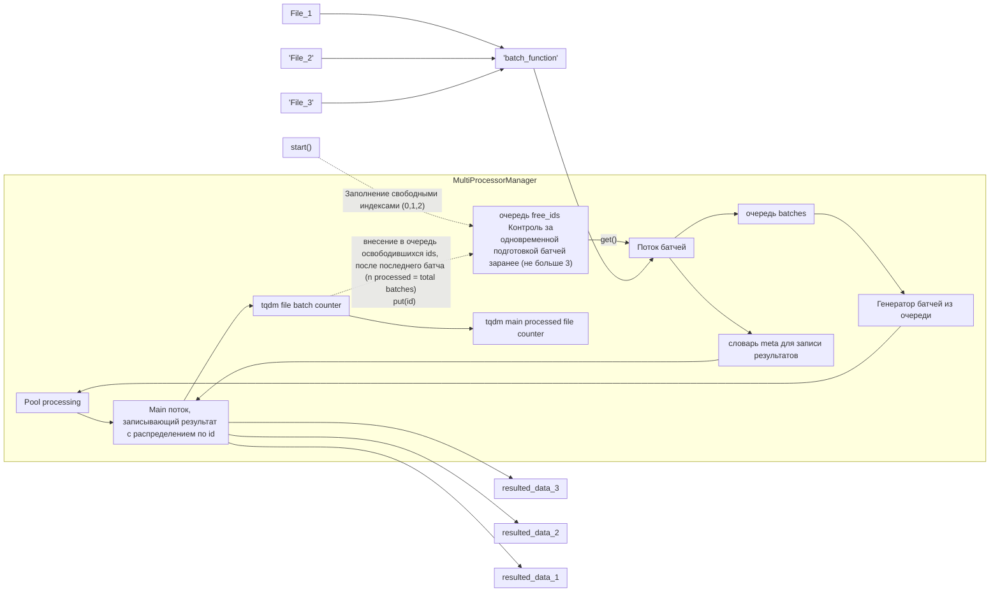
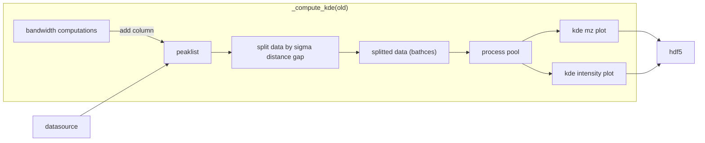
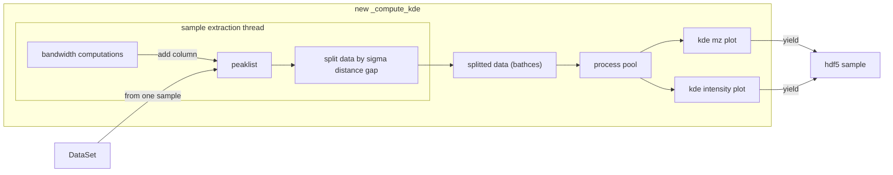

261114
Переписываю мультипроцессинг, дабы исключить:
1. Застои пула, в ожидании последних батчей обработки
2. Постоянную генерацию с нуля пула процессов (актуально для огромного кол-ва малых файлов)
3. Простой обработки, когда идёт дозапись результата перед переходом на новый файл

Что было решено сделать:
Создание класса MultiProcessorManager, отвечающий за непрерывное использование единожды созданного пула процессов и организации параллельной потоковой записи и создания батчей на свободном ядре/ядрах, дабы исключить и простаивание единственного ядра.
Упрощённая схема:

Теперь стоит задача сделать тоже самое для estimate_peak_density_kde, стараясь сохранить функцию _compute_kde:

